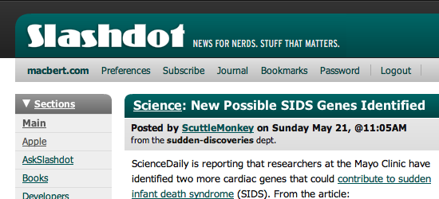

My brother [Alex](https://web.archive.org/web/20060530/http://www.macbert.com/)
has just won the
[Slashdot](https://web.archive.org/web/20060530/http://slashdot.org/) redesign
contest! Have a look at the [official
announcement](https://web.archive.org/web/20060530/http://slashdot.org/article.pl?sid=06/05/30/1531251)
and [Alex’s blog
entry](https://web.archive.org/web/20060530/http://summit.makalumedia.com/2006/05/30/the-slashdot-redux/).

The contest was announced a month ago, and has garnered wide interest in
geekdom, not to mention a huge number of submissions. Before the contest closed
a week ago, [Rob ‘CmdrTaco’
Malda](https://web.archive.org/web/20060530/http://cmdrtaco.net/) [wrote of
having been flooded with over two hundred
entries](https://web.archive.org/web/20060530/http://slashdot.org/~CmdrTaco/journal/135579),
which he eventually winnowed down to three finalists: [Peter
Lada’s](https://web.archive.org/web/20060530/http://www.proximalabs.com/slashdot/redesign3.html),
[Michael
Johnson’s](https://web.archive.org/web/20060530/http://insitemotion.com/slashdot2/)
and Alex’s.

All three finalists look good enough that choosing one of them comes down to
personal aesthetics (in this case, Rob’s.) However, I suspect what counted
strongly in Alex’s favor, despite a somewhat late entry into the game, was his
attention to detail in the design, combined with the sheer effort he put into
actually finishing up all the various screens and sections, without forgetting
the countless hours of cursing Internet Explorer till the cross-browser behavior
was pixel perfect
([BrowserCam](https://web.archive.org/web/20060530/http://www.browsercam.com/)
was a huge help, here.)

The contestants [were
constrained](https://web.archive.org/web/20060530/http://slashdot.org/articles/06/04/26/1512247.shtml)
to work within the existing HTML 4.0 page markup as far as possible, leaving the
revamp to be achieved with pure CSS, and effectively preventing any major
structural changes. As such, the new look & feel, soon to roll out, is mostly an
evolutionary touch-up of the venerable tech news site, keeping the existing
layout fairly intanct and certainly preserving the Slashdot identity,
predominant green color and all.

I think (in my entirely unbiased opinion, of course) that the end result turned
out rather fantastic, and will inject some much-needed zest back into the site.
Until now, Slashdot has looked pretty much the same as it did [way back in
1998](https://web.archive.org/web/20060530/http://web.archive.org/web/19981212021133/http://slashdot.org/),
and by today’s standards, that just ain’t too easy on the eyes. With brash
startups like
[Digg](https://web.archive.org/web/20060530/http://digg.com/design/Slashdot_CSS_Redesign_Winner_Announced)
and
[Reddit](https://web.archive.org/web/20060530/http://reddit.com/info/6wcg/comments)
now competing for the same eyeballs and advertising dollars, this facelift was
long overdue, and I do hope the visual upgrade is a mere harbinger of further
Slashdot improvements to come.

Alex is starting to accumulate a bit of a track record on design competitions,
having previously won [Wil Shipley’s blog redesign
contest](https://web.archive.org/web/20060530/http://wilshipley.com/blog/2005/11/failure-is-success.html),
whence he got an iPod in the mail. For the Slashdot contest, the prize is a
[MacBook
Pro](https://web.archive.org/web/20060530/http://www.apple.com/macbookpro/)
valued up to \$4500. Yummy!

(Notice the trend there with prizes made out of
[Apple](https://web.archive.org/web/20060530/http://www.apple.com/) hardware?
Worth their weight in gold.)

**Update** (2006-06-01): Over at the [The
Summit](https://web.archive.org/web/20060530/http://summit.makalumedia.com/),
I’ve posted a bit on [surviving the Slashdot
effect](https://web.archive.org/web/20060530/http://summit.makalumedia.com/2006/06/01/postscript-to-the-slashdot-effect/)
and [gauging the blogosphere reactions to the Slashdot
redesign](https://web.archive.org/web/20060530/http://summit.makalumedia.com/2006/06/01/gauging-reactions-to-the-slashdot-redesign/).
