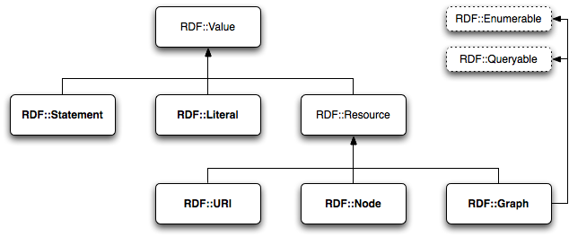

We have just released version 0.1.0 of
[RDF.rb](https://web.archive.org/web/20100309/http://rubygems.org/gems/rdf), our
[RDF](https://web.archive.org/web/20100309/http://www.w3.org/RDF/) library for
[Ruby](https://web.archive.org/web/20100309/http://www.ruby-lang.org/). This is
the first generally useful release of the library, so I will here introduce the
design philosophy and object model of the library as well as provide a tutorial
to using its core classes.

RDF.rb has
[extensive](https://web.archive.org/web/20100309/https://www.ohloh.net/p/rdf/factoids/2739953)
[API
documentation](https://web.archive.org/web/20100309/http://rdf.rubyforge.org/)
with many inline code examples, enjoys comprehensive
[RSpec](https://web.archive.org/web/20100309/http://rspec.info/) coverage, and
is immediately available via
[RubyGems](https://web.archive.org/web/20100309/http://rubygems.org/):

```console
$ [sudo] gem install rdf
```

Once installed, to load up the library in your own Ruby projects you need only
do:

```ruby
require 'rdf'
```

The RDF.rb [source code
repository](https://web.archive.org/web/20100309/http://github.com/bendiken/rdf)
is hosted on GitHub. You can obtain a local working copy of the source code as
follows:

```console
$ git clone git://github.com/bendiken/rdf.git
```

## The Design Philosophy

The design philosophy for RDF.rb differs somewhat from previous efforts at RDF
libraries for Ruby. Instead of a feature-packed RDF library that attempts to
include everything but the kitchen sink, we have rather aimed for something like
a lowest common denominator with well-defined, finite requirements.

Thus, RDF.rb is perhaps quickest described in terms of what it *isn't* and what
it *hasn't*:

- RDF.rb does not have any dependencies other than the
  [Addressable](https://web.archive.org/web/20100309/http://rubygems.org/gems/addressable)
  gem which provides improved URI handling over Ruby's standard library. We also
  guarantee that RDF.rb will never add any hard dependencies that would
  compromise its use on popular alternative Ruby implementations such as
  [JRuby](https://web.archive.org/web/20100309/http://jruby.org/).

- RDF.rb does not provide any resource-centric,
  [ORM](https://web.archive.org/web/20100309/http://en.wikipedia.org/wiki/Object-relational_mapping "object-relational mapper")-like
  abstractions to hide the essential statement-oriented nature of the API. Such
  abstractions may be useful, but they are beyond the scope of RDF.rb itself.

- RDF.rb does not, and will not, include built-in support for any RDF
  serialization formats other than
  [N-Triples](https://web.archive.org/web/20100309/http://en.wikipedia.org/wiki/N-Triples)
  and
  [N-Quads](https://web.archive.org/web/20100309/http://sw.deri.org/2008/07/n-quads/).
  However, it does define a
  [DSL](https://web.archive.org/web/20100309/http://en.wikipedia.org/wiki/Domain-specific_language "domain-specific language")
  and [common
  API](https://web.archive.org/web/20100309/http://rdf.rubyforge.org/RDF/Format.html)
  for adding support for other formats via third-party plugin gems. There
  presently exist RDF.rb-compatible
  [RDF::JSON](https://web.archive.org/web/20100309/http://rubygems.org/gems/rdf-json)
  and
  [RDF::TriX](https://web.archive.org/web/20100309/http://rubygems.org/gems/rdf-trix)
  gems that add initial
  [RDF/JSON](https://web.archive.org/web/20100309/http://n2.talis.com/wiki/RDF_JSON_Specification)
  and
  [TriX](https://web.archive.org/web/20100309/http://www.w3.org/2004/03/trix/)
  support, respectively.

- RDF.rb does not, and will not, include built-in support for any particular
  persistent RDF storage systems. However, it does define the interfaces that
  such storage adapters could be written to. Again, add-on gems are the way to
  go, and there already exists an in-the-works RDF.rb-compatible
  [RDF::Sesame](https://web.archive.org/web/20100309/http://rubygems.org/gems/rdf-sesame)
  gem that enables using [Sesame
  2.0](https://web.archive.org/web/20100309/http://www.openrdf.org/) HTTP
  endpoints with the [repository
  interface](https://web.archive.org/web/20100309/http://rdf.rubyforge.org/RDF/Repository.html)
  defined by RDF.rb.

- RDF.rb does not, and will not, include any built-in [RDF
  Schema](https://web.archive.org/web/20100309/http://en.wikipedia.org/wiki/RDF_Schema)
  or
  [OWL](https://web.archive.org/web/20100309/http://en.wikipedia.org/wiki/Web_Ontology_Language)
  inference capabilities. There exists an in-the-works RDF.rb-compatible
  [RDFS](https://web.archive.org/web/20100309/http://rubygems.org/gems/rdfs) gem
  that is intended to provide a naive proof-of-concept implementation of a
  [forward-chaining](https://web.archive.org/web/20100309/http://en.wikipedia.org/wiki/Forward_chaining)
  inference engine for the RDF Schema entailment rules.

- RDF.rb does not include any built-in
  [SPARQL](https://web.archive.org/web/20100309/http://en.wikipedia.org/wiki/SPARQL)
  functionality per se, though it will soon [provide
  support](https://web.archive.org/web/20100309/http://rdf.rubyforge.org/RDF/Query.html)
  for basic graph pattern (BGP) matching and could thus conceivably be used as
  the basis for a SPARQL engine written in Ruby.

- RDF.rb does not come with a license statement, but rather with the stringent
  hope that you have a nice day. RDF.rb is 100% [free and unencumbered public
  domain software](https://web.archive.org/web/20100309/http://unlicense.org/).
  You can copy, modify, use, and hack on it without any restrictions whatsoever.
  This means that authors of other RDF libraries for Ruby are perfectly welcome
  to steal any of our code, with or without attribution. So, if some code
  snippet or file may be of use to you, feel free to copy it and relicense it
  under whatever license you have released your own library with -- no need to
  include any copyright notices from us (since there are none), or even to
  mention us in the credits (we won't mind).

So that's what RDF.rb is not, but perhaps more important is what we want it to
be. There's no reason for simple RDF-based solutions to require enormous complex
libraries, storage engines, significant IDE configuration or XML pushups. We're
hoping to bring RDF to a world of agile programmers and startups, and to bring
existing [Linked
Data](https://web.archive.org/web/20100309/http://linkeddata.org/) enthusiasts
to a platform that encourages rapid innovation and programmer happiness. And
maybe everyone can have some fun along the way!

It is also our hope that the aforementioned minimalistic design approach and
extremely liberal licensing can help lead to the emergence of a semi-standard
Ruby object model for RDF, that is, a common core class hierarchy and API that
could be largely interoperable between a number of RDF libraries for Ruby.

With that in mind, let's proceed to have a look at RDF.rb's core object model.

## The Object Model

While RDF.rb is built to take full advantage of Ruby's [duck
typing](https://web.archive.org/web/20100309/http://en.wikipedia.org/wiki/Duck_typing)
and
[mixins](https://web.archive.org/web/20100309/http://en.wikipedia.org/wiki/Mixin),
it does also define a class hierarchy of RDF objects. If nothing else, this
inheritance tree is useful for `case/when` matching and also adheres to the
[principle of least
surprise](https://web.archive.org/web/20100309/http://en.wikipedia.org/wiki/Principle_of_least_astonishment)
for developers hailing from less dynamic programming languages.

The RDF.rb core class hierarchy looks like the following, and will seem
instantly familiar to anyone acquainted with [Sesame's object
model](https://web.archive.org/web/20100309/http://www.openrdf.org/doc/sesame2/2.3.1/apidocs/org/openrdf/model/package-summary.html):



The five core RDF.rb classes, all of them ultimately inheriting from
`RDF::Value`, are:

- `RDF::Literal` represents plain, language-tagged or datatyped literals.
- `RDF::URI` represents URI references (URLs and URNs).
- `RDF::Node` represents anonymous nodes (also known as blank nodes).
- `RDF::Statement` represents RDF statements (also known as triples).
- `RDF::Graph` represents anonymous or named graphs containing zero or more
  statements.

In addition, the two core RDF.rb interfaces (known as *mixins* in Ruby parlance)
are:

- `RDF::Enumerable` provides RDF-specific iteration methods for any collection
  of RDF statements.
- `RDF::Queryable` provides RDF-specific query methods for any collection of RDF
  statements.

Let's take a quick tour of each of these aforementioned core classes and mixins.

## Working with [RDF::URI](https://web.archive.org/web/20100309/http://rdf.rubyforge.org/RDF/URI.html)

URI references (URLs and URNs) are represented in RDF.rb as instances of the
`RDF::URI` class, which is based on the excellent
[Addressable::URI](https://web.archive.org/web/20100309/http://rubygems.org/gems/addressable)
library.

### Creating a URI reference

The `RDF::URI` constructor is overloaded to take either a URI string (anything
that responds to `#to_s`, actually) or an options hash of URI components. This
means that the following are two equivalent ways of constructing the same URI
reference:

```ruby
uri = RDF::URI.new("http://rdf.rubyforge.org/")

uri = RDF::URI.new({
  :scheme => 'http',
  :host   => 'rdf.rubyforge.org',
  :path   => '/',
})
```

The supported URI components are explained in the API documentation for
[`Addressable::URI.new`](https://web.archive.org/web/20100309/http://addressable.rubyforge.org/api/classes/Addressable/URI.html#M000013).

### Getting the string representation of a URI

Turning a URI reference back into a string works as usual in Ruby:

```ruby
uri.to_s        #=> "http://rdf.rubyforge.org/"
```

### Navigating URI hierarchies

`RDF::URI` supports the same set of instance methods as does `Addressable::URI`.
This means that the following methods, and many more, are available:

```ruby
uri = RDF::URI.new("http://rubygems.org/gems/rdf")

uri.absolute?   #=> true
uri.relative?   #=> false
uri.scheme      #=> "http"
uri.authority   #=> "rubygems.org"
uri.host        #=> "rubygems.org"
uri.port        #=> nil
uri.path        #=> "/gems/rdf"
uri.basename    #=> "rdf"
```

In addition, `RDF::URI` supports several convenience methods that can help you
navigate URI hierarchies without breaking a sweat:

```ruby
uri = RDF::URI.new("http://rubygems.org/")
uri = uri.join("gems", "rdf")

uri.to_s        #=> "http://rubygems.org/gems/rdf"

uri.parent      #=> RDF::URI.new("http://rubygems.org/gems/")
uri.root        #=> RDF::URI.new("http://rubygems.org/")
```

## Working with [RDF::Node](https://web.archive.org/web/20100309/http://rdf.rubyforge.org/RDF/Node.html)

Blank nodes are represented in RDF.rb as instances of the `RDF::Node` class.

### Creating a blank node with an implicit identifier

The simplest way to create a new blank node is as follows:

```ruby
bnode = RDF::Node.new
```

This will create a blank node with an identifier based on the internal Ruby
object ID of the `RDF::Node` instance. This nicely serves us as a unique
identifier for the duration of the Ruby process:

```ruby
bnode.id   #=> "2158816220"
bnode.to_s #=> "_:2158816220"
```

### Creating a blank node with a UUID identifier

You can also provide an explicit blank node identifier to the `RDF::Node`
constructor. This is particularly useful when serializing or parsing RDF data,
where you generally need to maintain a mapping of blank node identifiers to
blank node instances.

The constructor argument can be any string or any object that responds to
`#to_s`. For example, say that you wanted to create a blank node instance having
a globally-unique
[UUID](https://web.archive.org/web/20100309/http://en.wikipedia.org/wiki/Universally_Unique_Identifier "universally unique identifier")
as its identifier. Here's how you would do this with the help of the [UUID
gem](https://web.archive.org/web/20100309/http://rubygems.org/gems/uuid):

```ruby
require 'uuid'

bnode = RDF::Node.new(UUID.generate)
```

The above is a fairly common use case, so RDF.rb actually provides a convenience
class method for creating UUID-based blank nodes. The following will use either
the UUID or the
[UUIDTools](https://web.archive.org/web/20100309/http://rubygems.org/gems/uuidtools)
gem, whichever happens to be available:

```ruby
bnode = RDF::Node.uuid
bnode.to_s #=> "_:504c0a30-0d11-012d-3f50-001b63cac539"
```

## Working with [RDF::Literal](https://web.archive.org/web/20100309/http://rdf.rubyforge.org/RDF/Literal.html)

All three types of RDF literals -- plain, language-tagged and datatyped -- are
represented in RDF.rb as instances of the `RDF::Literal` class.

### Creating a plain literal

Create plain literals by passing in a string to the `RDF::Literal` constructor:

```ruby
hello = RDF::Literal.new("Hello, world!")

hello.plain?         #=> true
hello.has_language?  #=> false
hello.has_datatype?  #=> false
```

Note, however, that in most RDF.rb interfaces you will *not* in fact need to
wrap language-agnostic, non-datatyped strings into `RDF::Literal` instances;
this is done automatically when needed, allowing you the convenience of, say,
passing in a plain old Ruby string as the object value when constructing an
`RDF::Statement` instance.

### Creating a language-tagged literal

To create language-tagged literals, pass in an additional [ISO language
code](https://web.archive.org/web/20100309/http://en.wikipedia.org/wiki/ISO_639-1)
to the `:language` option of the `RDF::Literal` constructor:

```ruby
hello = RDF::Literal.new("Hello!", :language => :en)

hello.has_language?  #=> true
hello.language       #=> :en
```

The language code can be given as either a symbol, a string, or indeed anything
that responds to the `#to_s` method:

```ruby
RDF::Literal.new("Hello!", :language => :en)
RDF::Literal.new("Wazup?", :language => :"en-US")
RDF::Literal.new("Hej!",   :language => "sv")
RDF::Literal.new("¡Hola!", :language => ["es"])
```

### Creating an explicitly datatyped literal

Datatyped literals are created similarly, by passing in a datatype URI to the
`:datatype` option of the `RDF::Literal` constructor:

```ruby
date = RDF::Literal.new("2010-12-31", :datatype => RDF::XSD.date)

date.has_datatype?   #=> true
date.datatype        #=> RDF::XSD.date
```

The datatype URI can be given as any object that responds to either the
`#to_uri` method or the `#to_s` method. In the example above, we've called the
`#date` method on the `RDF::XSD` vocabulary class which represents the [XML
Schema](https://web.archive.org/web/20100309/http://en.wikipedia.org/wiki/XML_Schema_(W3C))
datatypes vocabulary; this returns an `RDF::URI` instance representing the URI
for the `xsd:date` datatype.

### Creating implicitly datatyped literals

You'll be glad to hear that you don't necessarily have to always explicitly
specify a datatype URI when creating a datatyped literal. RDF.rb supports a
degree of automatic mapping between Ruby classes and XML Schema datatypes.

In most common cases, you can just pass in the Ruby value to the `RDF::Literal`
constructor as-is, with the correct XML Schema datatype being automatically set
by RDF.rb:

```ruby
today = RDF::Literal.new(Date.today)

today.has_datatype?  #=> true
today.datatype       #=> RDF::XSD.date
```

The following implicit datatype mappings are presently supported by RDF.rb:

```ruby
RDF::Literal.new(false).datatype               #=> RDF::XSD.boolean
RDF::Literal.new(true).datatype                #=> RDF::XSD.boolean
RDF::Literal.new(123).datatype                 #=> RDF::XSD.integer
RDF::Literal.new(9223372036854775807).datatype #=> RDF::XSD.integer
RDF::Literal.new(3.1415).datatype              #=> RDF::XSD.double
RDF::Literal.new(Date.new(2010)).datatype      #=> RDF::XSD.date
RDF::Literal.new(DateTime.new(2010)).datatype  #=> RDF::XSD.dateTime
RDF::Literal.new(Time.now).datatype            #=> RDF::XSD.dateTime
```

## Working with [RDF::Statement](https://web.archive.org/web/20100309/http://rdf.rubyforge.org/RDF/Statement.html)

RDF statements are represented in RDF.rb as instances of the `RDF::Statement`
class. Statements can be *triples* -- constituted of a *subject*, a *predicate*,
and an *object* -- or they can be *quads* that also have an additional *context*
indicating the named graph that they are part of.

### Creating an RDF statement

Creating a triple works exactly as you'd expect:

```ruby
subject   = RDF::URI.new("http://rubygems.org/gems/rdf")
predicate = RDF::DC.creator
object    = RDF::URI.new("http://ar.to/#self")

RDF::Statement.new(subject, predicate, object)
```

The subject should be an `RDF::Resource`, the predicate an `RDF::URI`, and the
object an `RDF::Value`. These constraints are not enforced, however, allowing
you to use any duck-typed equivalents as components of statements.

### Creating an RDF statement with a context

Pass in a URI reference in an extra `:context` option to the `RDF::Statement`
constructor to create a quad:

```ruby
context   = RDF::URI.new("http://rubygems.org/")
subject   = RDF::URI.new("http://rubygems.org/gems/rdf")
predicate = RDF::DC.creator
object    = RDF::URI.new("http://ar.to/#self")

RDF::Statement.new(subject, predicate, object, :context => context)
```

### Creating an RDF statement from a hash

It's also worth mentioning that the `RDF::Statement` constructor is overloaded
to enable instantiating statements from an options hash, as follows:

```ruby
RDF::Statement.new({
  :subject   => RDF::URI.new("http://rubygems.org/gems/rdf"),
  :predicate => RDF::DC.creator,
  :object    => RDF::URI.new("http://ar.to/#self"),
})
```

The `:context` option can also be given, as before. Use whichever method of
instantiating statements that you happen to prefer.

Statement objects also support a `#to_hash` method that provides the inverse
operation:

```ruby
statement.to_hash   #=> { :subject   => ...,
                    #     :predicate => ..., 
                    #     :object    => ... }
```

### Accessing RDF statement components

Access the RDF statement components -- the subject, the predicate, and the
object -- as follows:

```ruby
statement.subject   #=> an RDF::Resource
statement.predicate #=> an RDF::URI
statement.object    #=> an RDF::Value
```

Since statements can also have an optional context, the following will return
either `nil` or else an `RDF::Resource` instance:

```ruby
statement.context   #=> an RDF::Resource or nil
```

### Working directly with triples and quads

Because RDF.rb is duck-typed, you can often directly use a three- or four-item
Ruby array in place of an `RDF::Statement` instance. This can sometimes feel
less cumbersome than instantiating a statement object, and it may also save some
memory if you need to deal with a very large amount of in-memory RDF statements.
We'll see some examples of doing this this later on.

Converting from statement objects to Ruby arrays is trivial:

```ruby
statement.to_triple #=> [subject, predicate, object]
statement.to_quad   #=> [subject, predicate, object, context]
```

Likewise, instantiating a statement object from a triple represented as a Ruby
array is straightforward enough:

```ruby
RDF::Statement.new(*[subject, predicate, object])
```

## Working with [RDF::Graph](https://web.archive.org/web/20100309/http://rdf.rubyforge.org/RDF/Graph.html)

RDF graphs are represented in RDF.rb as instances of the `RDF::Graph` class.
Note that most of the functionality in this class actually comes from the
`RDF::Enumerable` and `RDF::Queryable` mixins, which we'll examine further
below.

### Creating an anonymous graph

Creating a new unnamed graph works just as you'd expect:

```ruby
graph = RDF::Graph.new

graph.named? #=> false
graph.to_uri #=> nil
```

### Creating a named graph

To create a [named
graph](https://web.archive.org/web/20100309/http://www.w3.org/2004/03/trix/),
just pass in a blank node or a URI reference to the `RDF::Graph` constructor:

```ruby
graph = RDF::Graph.new("http://rubygems.org/")

graph.named? #=> true
graph.to_uri #=> RDF::URI.new("http://rubygems.org/")
```

### Adding statements to a graph

To insert RDF statements into a graph, use the `#<<` operator or the `#insert`
method:

```ruby
graph << statement

graph.insert(*statements)
```

Let's add some RDF statements to an unnamed graph, taking advantage of the
aforementioned duck-typing convenience that lets us represent triples directly
using Ruby arrays, and plain literals directly using Ruby strings:

```ruby
rdfrb = RDF::URI.new("http://rubygems.org/gems/rdf")
arto  = RDF::URI.new("http://ar.to/#self")

graph = RDF::Graph.new do
  self << [rdfrb, RDF::DC.title,   "RDF.rb"]
  self << [rdfrb, RDF::DC.creator, arto]
end
```

If you prefer, you can also be more explicit and use the equivalent `#insert`
method form instead of the `#<<` operator:

```ruby
graph.insert([rdfrb, RDF::DC.title,   "RDF.rb"])
graph.insert([rdfrb, RDF::DC.creator, arto])
```

### Deleting statements from a graph

To delete RDF statements from a graph, use the `#delete` method:

```ruby
graph.delete(*statements)
```

Deleting the statements we inserted in the previous example works like so:

```ruby
graph.delete([rdfrb, RDF::DC.title,   "RDF.rb"])
graph.delete([rdfrb, RDF::DC.creator, arto])
```

Alternatively, we can use wildcard matching (where `nil` stands for a "match
anything" wildcard) to simply delete every statement in the graph that has a
particular subject:

```ruby
graph.delete([rdfrb, nil, nil])
```

For even more convenience, since non-existent array subscripts in Ruby return
`nil`, the following abbreviation is exactly equivalent to the previous example:

```ruby
graph.delete([rdfrb])
```

## Working with [RDF::Enumerable](https://web.archive.org/web/20100309/http://rdf.rubyforge.org/RDF/Enumerable.html)

`RDF::Enumerable` is a mixin module that provides RDF-specific iteration methods
for any object capable of yielding RDF statements.

In what follows we will consider some of the key `RDF::Enumerable` methods
specifically as used in instances of the `RDF::Graph` class.

### Checking whether any statements exist

Just as with most of Ruby's built-in collection classes, graphs support an
`#empty?` predicate method that returns a boolean:

```ruby
graph.empty?      #=> true or false
```

### Checking how many statements exist

You can use `#count` -- or if you prefer, the equivalent alias `#size` -- to
return the number of RDF statements in a graph:

```ruby
graph.count
```

### Checking whether a specific statement exists

If you need to check whether a specific RDF statement is included in the graph,
use the following method:

```ruby
graph.has_statement?(RDF::Statement.new(subject, predicate, object))
```

There also exists an otherwise equivalent convenience method that takes a Ruby
array as its argument instead of an `RDF::Statement` instance:

```ruby
graph.has_triple?([subject, predicate, object])
```

### Checking whether a specific value exists

If you need to check whether a particular value is included in the graph as a
component of one or more statements, use one of the following three methods:

```ruby
graph.has_subject?(RDF::URI.new("http://rdf.rubyforge.org/"))

graph.has_predicate?(RDF::DC.creator)

graph.has_object?(RDF::Literal.new("Hello!", :language => :en))
```

### Enumerating all statements

The following method yields every statement in the graph as an `RDF::Statement`
instance:

```ruby
graph.each_statement do |statement|
  puts statement.inspect
end
```

You can also use `#each` as a shorter alias for `#each_statement`, though we
ourselves consider using the more explicit form to be stylistically preferred.

If you don't require `RDF::Statement` instances and simply want to get directly
at the triple components of statements, do the following instead:

```ruby
graph.each_triple do |subject, predicate, object|
  puts [subject, predicate, object].inspect
end
```

Similarly, you can enumerate the graph using quads as well:

```ruby
graph.each_quad do |subject, predicate, object, context|
  puts [subject, predicate, object, context].inspect
end
```

Note that for unnamed graphs, the yielded `context` will always be `nil`; for
named graphs, it will always be the same `RDF::Resource` instance as would be
returned by calling `graph.context`.

### Obtaining all statements

If instead of enumerating statements one-by-one you wish to obtain all the data
in a graph in one go as an array of statements, the following method does just
that:

```ruby
graph.statements  #=> [RDF::Statement(subject1, predicate1, object1), ...]
```

Naturally, there also exist the usual alternative methods that give you the
statements in the form of raw triples or quads represented as Ruby arrays:

```ruby
graph.triples     #=> [[subject1, predicate1, object1], ...]
graph.quads       #=> [[subject1, predicate1, object1, context1], ...]
```

### Enumerating all values

A particularly useful set of methods is the following, which yield unique
statement components from a graph:

```ruby
graph.each_subject   { |value| puts value.inspect }
graph.each_predicate { |value| puts value.inspect }
graph.each_object    { |value| puts value.inspect }
```

For instance, `#each_subject` yields every unique statement subject in the
graph, never yielding the same subject twice.

### Obtaining all unique values

Again, instead of yielding unique values one-by-one, you can obtain them in one
go with the following methods:

```ruby
graph.subjects    #=> [subject1, subject2, subject3, ...]
graph.predicates  #=> [predicate1, predicate2, predicate3, ...]
graph.objects     #=> [object1, object2, object3, ...]
```

Here, `#subjects` returns an array containing all unique statement subjects in
the graph, and `#predicates` and `#objects` do the same for statement predicates
and objects respectively.

## Working with [RDF::Queryable](https://web.archive.org/web/20100309/http://rdf.rubyforge.org/RDF/Queryable.html)

`RDF::Queryable` is a mixin that provides RDF-specific query methods for any
object capable of yielding RDF statements. At present this means simple
subject-predicate-object queries, but extended basic graph pattern matching will
be available in a future release of RDF.rb.

In what follows we will consider `RDF::Queryable` methods specifically as used
in instances of the `RDF::Graph` class.

### Querying for specific statements

The simplest type of query is one that specifies all statement components, as in
the following:

```ruby
statements = graph.query([subject, predicate, object])
```

The result set here would contain either no statements if the query didn't match
(that is, the given statement didn't exist in the graph), or otherwise at the
most the single matched statement.

The `#query` method can also take a block, in which case matching statements are
yielded to the block one after another instead of returned as a result set:

```ruby
graph.query([subject, predicate, object]) do |statement|
  puts statement.inspect
end
```

### Querying with wildcard components

You can replace any of the query components with `nil` to perform a wildcard
match. For example, in the following we query for all `dc:title` values for a
given subject resource:

```ruby
rdfrb = RDF::URI.new("http://rubygems.org/gems/rdf")

graph.query([rdfrb, RDF::DC.title, nil]) do |statement|
  puts "dc:title = #{statement.object.inspect}"
end
```

We can also query for any and all statements related to a given subject
resource:

```ruby
graph.query([rdfrb, nil, nil]) do |statement|
  puts "#{statement.predicate.inspect} = #{statement.object.inspect}"
end
```

The result sets returned by `#query` also implement `RDF::Enumerable` and
`RDF::Queryable`, so it is possible to chain several queries to incrementally
refine a result set:

```ruby
graph.query([rdfrb]).query([nil, RDF::DC.title])
```

Likewise, it is of course possible to chain `RDF::Queryable` operations with
methods from `RDF::Enumerable`:

```ruby
graph.query([nil, RDF::DC.title]).each_subject do |subject|
  puts subject.inspect
end
```

## The Mailing List

If you have feedback regarding RDF.rb, please contact us either
[privately](https://web.archive.org/web/20100309/http://github.com/datagraph) or
via the
[public-rdf-ruby@w3.org](https://web.archive.org/web/20100309/http://lists.w3.org/Archives/Public/public-rdf-ruby/)
mailing list. Bug reports should go to the [issue
queue](https://web.archive.org/web/20100309/http://github.com/bendiken/rdf/issues)
on GitHub.

## Coming Up

In upcoming RDF.rb tutorials we will see how to work with existing RDF
vocabularies, how to serialize and parse RDF data using RDF.rb, how to write an
RDF.rb plugin, how to use RDF.rb with [Ruby on
Rails](https://web.archive.org/web/20100309/http://rubyonrails.org/) 3.0, and
much more. [Stay
tuned](https://web.archive.org/web/20100309/http://feeds.feedburner.com/datagraph)!
