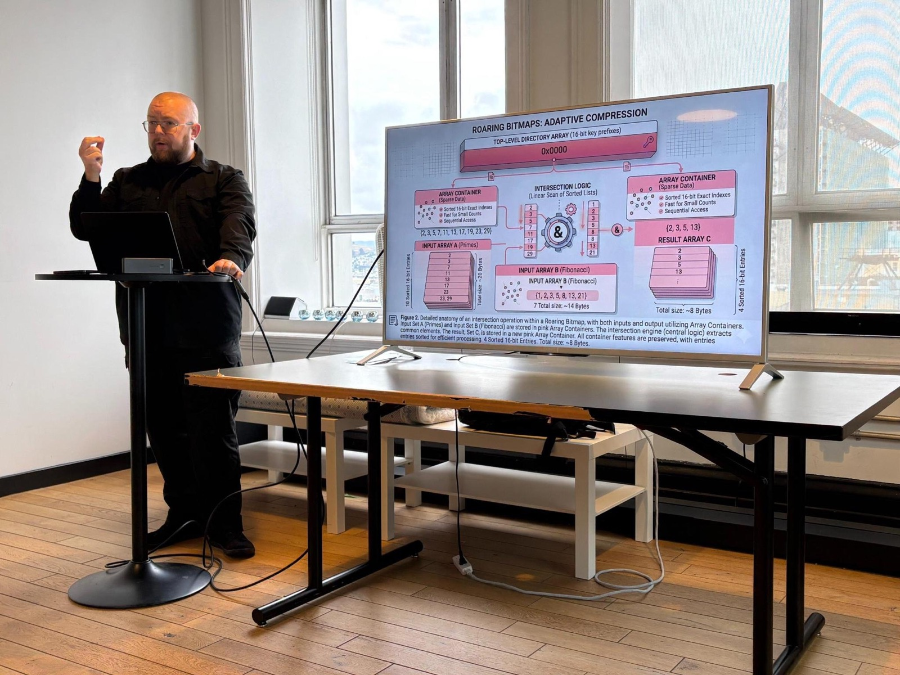
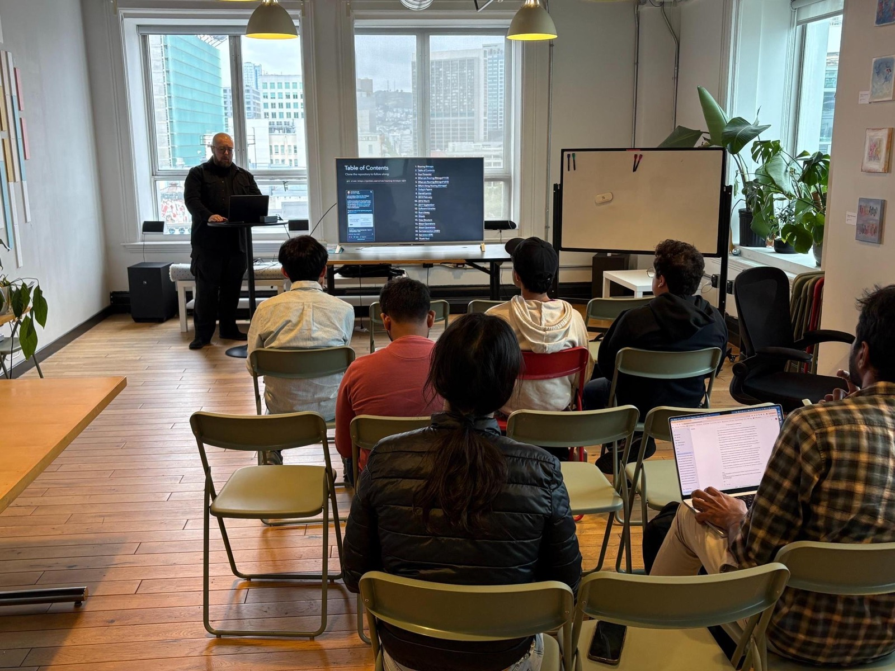

The primary reading was [_Consistently Faster and Smaller Compressed Bitmaps
with Roaring_](https://arxiv.org/abs/1603.06549) by Daniel Lemire, Gregory
Ssi-Yan-Kai, and Owen Kaser, and the follow-along code uses the Rust
implementation, [roaring-rs](https://github.com/RoaringBitmap/roaring-rs).

