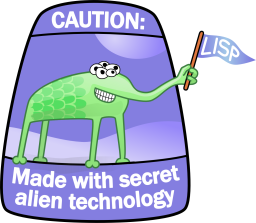

<em><small>Originally published at <a href="https://web.archive.org/web/20080517155108/http://bendiken.net/2006/07/05/spam-filters-alien-technology-and-ruby-on-rails">http://bendiken.net/2006/07/05/spam-filters-alien-technology-and-ruby-on-rails</a>.</small></em>

When Paul Graham’s [A Plan for
Spam](https://web.archive.org/web/20060705/http://www.paulgraham.com/spam.html)
made its dramatic entrance into the anti-spam battle four years ago, it heralded
the beginning of the end for spam — as we knew spam back then, anyway. Applying
[a simple statistical
approach](https://web.archive.org/web/20060705/http://www.paulgraham.com/better.html),
based on [word frequency
analysis](https://web.archive.org/web/20060705/http://en.wikipedia.org/wiki/Frequency_analysis)
with a [naive Bayesian
classifier](https://web.archive.org/web/20060705/http://en.wikipedia.org/wiki/Naive_Bayes_classifier),
Graham described how to create a spam filter accurate enough (99+%) that [false
positives](https://web.archive.org/web/20060705/http://en.wikipedia.org/wiki/False_positive)
effectively ceased to be an issue.

The central idea of the Graham Algorithm was quickly adopted en masse by spam
filters, and as a result, the spam arms race has in the past few years tipped in
favor of the good guys. “Successful” spam has devolved into exactly what Graham
predicted it would: *“some completely neutral text followed by a URL.”* For me
personally, the combination of good server- and client-side filters has made
spam yesterday’s problem. (Well, that, and using
[Gmail](https://web.archive.org/web/20060705/http://mail.google.com/) as a
front-end for lower-priority e-mail; [spam all you
want](https://web.archive.org/web/20060705/http://bendiken.net/feedback), it’s
Google’s problem and they’re up to the task.)

Recently at
[\$WORK](https://web.archive.org/web/20060705/http://www.makalumedia.com/),
we’ve succeeded in applying similar [text
classification](https://web.archive.org/web/20060705/http://en.wikipedia.org/wiki/Text_classification)
principles to another unrelated problem area, with the intent of forcing the
computer to do the tedious job it was invented for, allowing us super-apes, in
turn, to spend more time under a palm tree on the nearby beach, sipping [tinto
de
verano](https://web.archive.org/web/20060705/http://en.wikipedia.org/wiki/Tinto_de_verano)
and working out answers to deep existential questions, or whatever else it is
that one does on the beach (*note to self: need more practice*).

The exact details of this covert project will have to await its escape into the
wild, should it ever evolve the capability for that. For the time being, some of
the technically more interesting tidbits will have to do as fodder for my
ramblings.

First, as with most of our internal development, and an ever-increasing
percentage of our client projects, this system was developed using the
high-productivity [Ruby on
Rails](https://web.archive.org/web/20060705/http://www.rubyonrails.org/)
framework, and reached the magical 0.1.0 mark (i.e., pre-alpha, but usable
enough to solve many of the developers’ own needs) in less than a man-week of
intensive coding (not to forget the skimming of a good number of [research
papers](https://web.archive.org/web/20060705/http://www.paulgraham.com/bayeslinks.html)
related to the subject).

However, to ensure [a permanent gap on the
competition](https://web.archive.org/web/20060705/http://www.paulgraham.com/avg.html)
(after all, it sometimes seems like half the world has already jumped onto
Rails), we also pulled out the big guns: the top-secret [alien
technology](https://web.archive.org/web/20060705/http://lispers.org/) known as
[Lisp](https://web.archive.org/web/20060705/http://en.wikipedia.org/wiki/Lisp_programming_language).

(Don’t be fooled by the devious code name, intended to confound us earthlings
with spurious ideas relating to speech defects — this is seriously powerful
stuff:
[exposure](https://web.archive.org/web/20060705/http://www.gigamonkeys.com/book/)
is guaranteed to subtly but permanently [alter your brain
structure](https://web.archive.org/web/20060705/http://www.catb.org/esr/faqs/hacker-howto.html)
in ways not yet fully understood. In fact, the aliens have
[theorized](https://web.archive.org/web/20060705/http://wiki.alu.org/Glenn_Ehrlich_Road_to_Lisp)
that the Universe
[may](https://web.archive.org/web/20060705/http://wiki.alu.org/Svein_Ove_Aas%27s_Road_to_Lisp)
actually be one giant Quantum Lisp machine, explaining how it is possible that
lots of irritating, seemingly superfluous parentheses can act as magic
incantations conveying an apparently inexhaustible power as per the principle of
[Clarke’s Third
Law](https://web.archive.org/web/20060705/http://en.wikipedia.org/wiki/Clarke%27s_three_laws).
But that’s neither here nor there for our present purposes.)

In our case, we simply integrated into the Rails system an interpreter for a
subset of
[Scheme](https://web.archive.org/web/20060705/http://www.schemers.org/), a Lisp
derivative; thus no doubt confirming [Greenspun’s Tenth
Rule](https://web.archive.org/web/20060705/http://en.wikipedia.org/wiki/Greenspun%27s_Tenth_Rule)
once again. (Well, to be fair, the Lisp interpreter in question is only some few
hundred lines of fairly elegant Ruby code.)

The system’s top-level classification and scoring algorithms are implemented in
this Lisp subset, allowing us to easily fine-tune and try out new tweaks at
runtime, and perhaps in the future letting us semi-automatically pit various
competing implementations against each other in a manner not dissimilar to a
[genetic
algorithm](https://web.archive.org/web/20060705/http://en.wikipedia.org/wiki/Genetic_algorithm).

Due to the combined
[RAD-factors](https://web.archive.org/web/20060705/http://en.wikipedia.org/wiki/Rapid_application_development)
of Rails and Lisp, we quickly proceeded through a number of intermediate
prototypes along the way, starting from a short-lived
[Ferret-based](https://web.archive.org/web/20060705/http://ferret.davebalmain.com/trac/)
implementation, evolving to a hand-rolled tokenizer and SQL-backed corpora
storage, and eventually ending up with the current version that delegates the
content classification to a [Dr.
Strangelove-inspired](https://web.archive.org/web/20060705/http://en.wikipedia.org/wiki/Dr._Strangelove_or:_How_I_Learned_to_Stop_Worrying_and_Love_the_Bomb)
piece of excellent software called the [CRM114 Controllable Regex
Mutilator](https://web.archive.org/web/20060705/http://crm114.sourceforge.net/).

(Speaking of CRM114, I was surprised to not find any existing Ruby bindings for
it, and thus took the time to transcribe a previous [Python
wrapper](https://web.archive.org/web/20060705/http://www.elegantchaos.com/node/129)
into a Ruby version, to be released shortly.)

Anyway, the system appears to work more or less according to spec, but
definitely still needs some more tweaking before embarking on world domination.
For one thing, all this number crunching is, well, rather **heavy** (let’s just
say it’s a good thing we have A/C in the server room where the development box
is located). Although CRM114 itself is pretty light on its feet, we’re dealing
with an exponentially growing data set, and the next challenge will be to put
some checks on resource consumption.

So, for the time being, we’re not going to let the development box interact with
our [space systems
department](https://web.archive.org/web/20060705/http://www.makalumedia.com/space),
to prevent any non-regulated growth or inadvertent contact with the
[aliens](https://web.archive.org/web/20060705/http://www.lisperati.com/logo.html).
More updates to follow as they happen.

***Note to self**: too many [tinto
veranos](https://web.archive.org/web/20060705/http://images.google.com/images?q=tinto%20de%20verano)
can make you forget there’s a fine line between tongue-in-cheek surrealism and
plain-bad geek humor.*

**Update 2006/11/06:** I’ve released [the Ruby interface to CRM114 on
RubyForge](https://web.archive.org/web/20060705/http://rubyforge.org/projects/crm114/).
